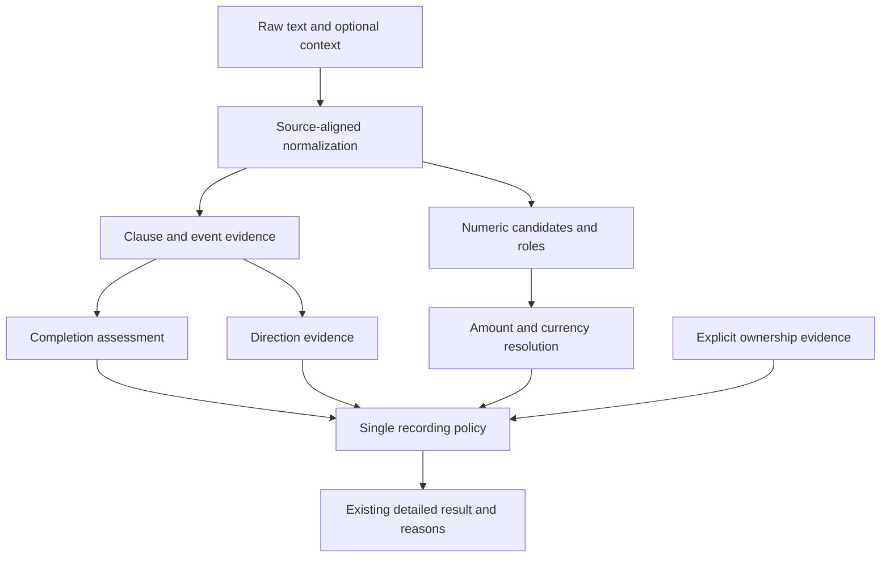

# Core money roadmap — 2026-10-30

This is the active implementation plan. It supersedes older category-first and
encoder-experiment next steps in project notes. Update the checklist here and
the current STATE/HANDOFF summary after each material result. Historical models,
reports, frozen labels and reserved sets remain intact.

## Execution contract for the next agent

The checklist below is an ordered work queue, not a collection of independent
ideas. Use this block to resume after a context reset. The YAML is a human- and
agent-readable status record; it is not consumed by a program.

```yaml
workspace: C:/Users/mustafa/Desktop/msroof
active_milestone: R6_developer_testing_ready_release_open
completed_milestones: [R0, R1, R2, R3, R4, R5]
next_action: use_compact_tester_checklist_and_triage_observed_core_mismatches
then: [freeze_any_new_reproducible_mismatch_with_evidence, repair_only_proven_contract_gaps, preserve_independent_release_gate]
owner_route_choice_20261103: continue_existing_development_testing
collection: deferred_by_owner
format_repair: data/reports/behavior/core_format_robustness_after_v1.json
format_integrity: data/reports/behavior/core_format_robustness_integrity_v1.json
amount_ownership_integrity: data/reports/behavior/core_amount_ownership_integrity_v1.json
multiple_movements_integrity: data/reports/behavior/core_multiple_movements_integrity_v1.json
coordinated_movements_integrity: data/reports/behavior/core_coordinated_movements_integrity_v1.json
plain_conjunction_review: data/reports/behavior/core_plain_conjunction_review_v1.json
plain_conjunction_repair: data/reports/behavior/core_plain_conjunction_repair_integrity_v1.json
source_review: data/sources/transactions/validation_source_review_20261102.json
source_plan: docs/JORDAN_SMS_VALIDATION_SOURCING.md
route_choice: existing_development_testing_selected
new_messages_collected: 0
startup_guard_report: data/reports/behavior/core_money_r6_startup_guard_final_v1.json
validation_preflight: data/reports/behavior/core_validation_preflight_v1.json
validation_preflight_doc: docs/CORE_VALIDATION_PREFLIGHT.md
tester_report: data/reports/behavior/core_money_r6_tester_v1.json
readiness_inventory: data/reports/behavior/core_money_r6_inventory_v1.json
readiness_refresh: data/reports/behavior/core_money_r6_readiness_refresh_v1.json
tester_checklist: docs/CORE_TESTER_CHECKLIST.md
readiness_doc: docs/CORE_MONEY_READINESS.md
readiness_inventory_inference: none
baseline: data/reports/behavior/core_money_v1_baseline.json
case_fixture: tests/fixtures/core_money_v1.json
baseline_cases: 52
baseline_matches_per_runtime: 47
current_matches_per_runtime: 52
current_report: data/reports/behavior/core_money_v1_after_r5a_unmarked.json
unmarked_report: data/reports/behavior/core_money_r5a_unmarked_comparison.json
settlement_report: data/reports/behavior/core_money_r5a_settlement_comparison.json
known_error_queue: resolved
remaining_contract_gap: none_known_in_measured_queue
income_transfer_report: data/reports/behavior/core_money_r5a_income_transfers_comparison.json
account_movement_report: data/reports/behavior/core_money_r5a_account_movements_final_comparison.json
posted_repair_report: data/reports/behavior/core_money_r5a_posted_comparison.json
completed_review: data/reports/behavior/core_money_r5a_completed_review.json
nontransaction_repair_report: data/reports/behavior/core_money_r5a_nontransaction_comparison.json
uncertainty_repair_report: data/reports/behavior/core_money_r5a_uncertainty_comparison.json
frame_repair_report: data/reports/behavior/core_money_r5a_frame_repair.json
residual_report: data/reports/behavior/core_money_r5_residuals.json
repair_queue: data/reports/behavior/core_money_r5_repair_queue.json
r5_exit: met_finite_conformance_only
release_gate: independent_evidence_and_thresholds_unset
baseline_core_parity_mismatches: 0
baseline_failing_case_ids: [otp-en, declined-en, promo, unknown-outcome, bill-ar]
category_work: deferred
new_model_training: not_authorized
scope_reserved_32: not_inferred
merchant_reserved_29: not_inferred
```

**Resume procedure:**

R0–R5 are complete for finite development conformance. R6's parser fixes,
current readiness refresh and optional tester checklist are complete. Read
[CORE_MONEY_READINESS.md](CORE_MONEY_READINESS.md) and
[CORE_TESTER_CHECKLIST.md](CORE_TESTER_CHECKLIST.md) before further changes.
Triage newly observed mismatches against the existing contract; do not add
synthetic variants just to grow the counts. The owner chose existing-data
checks on 2026-11-03 and deferred collection. The intake remains empty,
independent release evidence and thresholds remain open, and zero/signed and
duplicate-ingestion policies remain unresolved. The parser checkpoint is on
`origin/main`; Git publication was explicitly authorized for this integration
and readiness follow-up. Steps 2–6 below preserve the R1 recipe as historical
reference. No fresh fitting, independent or reserved-set scoring, deployment,
source outreach or deletion follows from this continuation.

1. Read `STATE.md`, this execution contract and the active milestone. Consult
   `.agents/HANDOFF.md` for durable decisions and only the linked evidence needed
   for the task. Use the actual `msroof` checkout; verify the working directory
   and Git status before editing. Preserve unrelated existing changes.
2. R1.0: reproduce the known failing design-only test by name. Inspect the
   preserved proposal snapshot and hash bindings. Make the test run against an
   isolated proposal context while retaining its zero-authorization assertion;
   don't alter the frozen producer, execution config or historical evidence.
   If snapshot isolation cannot preserve those constraints, document the exact
   blocker and continue the independent R1 engine investigation.
3. R1.1: examine each of the five baseline mismatch records and corresponding
   source clauses and expectations. Record any genuine policy ambiguity before
   implementing that part. Preserve the existing fixture and historical report;
   if a weak expectation needs correction, create a traceable versioned correction.
4. R1.2: implement one general, clause-scoped repair at a time in the shared
   contracts and corresponding Python/TypeScript paths. Add positive and
   negative contrasts around its actual boundary, then run targeted safeguards
   and compare outputs before continuing. Never special-case fixture IDs.
5. R1.3: run the core evaluator against all three runtimes using a **new** report
   path. Inspect every mismatch and parity difference, including cases with
   partial expected fields. Existing report paths are immutable; if a path is
   already taken, use another descriptive version instead of overwriting it.
6. R1.4: run the relevant existing authorization, number, ownership and compatibility
   checks, then the full runner once the known harness issue is resolved. Report
   exactly what ran and any remaining failures. Advance to R2 only after the R1
   exit criteria below are met; don't interpret finite-suite success as independent
   accuracy or model promotion.
7. After a material result, mark the relevant checklist item only when its exit
   evidence exists; update the status block, `STATE.md` and `.agents/HANDOFF.md`
   with the next action and links to reports. Keep the handoff compact and avoid
   duplicating full diagnostic logs. Continue authorized routine work without
   requesting another approval at each step.

**Stop or branch rules:** If a pending fee/FX/zero/dedup policy controls a case,
leave it unscored and continue independent work; ask the owner only before a
decision-dependent behavior change. Preserve raw private SMS outside tracked
fixtures. Stop before a new fit, reserved-set inference, deployment or publication
unless separately authorized. A failed historical experiment is never resumed,
retrained, rebound or deleted. Never replace a stored truth merely to make a test
pass. If a check cannot run, preserve its output and report it as unverified.

**Baseline commands** (from the workspace; isolated environment already exists):

```powershell
.local-backups/sms_completion_encoder_v1/env/Scripts/python.exe -X utf8 -m unittest tests.python.test_auxiliary_status_protocol.AuxiliaryStatusProtocolTests.test_frozen_view_baseline_metadata_and_unapproved_budget
.local-backups/sms_completion_encoder_v1/env/Scripts/python.exe -X utf8 -m unittest tests.python.test_core_money_fixture
.local-backups/sms_completion_encoder_v1/env/Scripts/python.exe -X utf8 -m tools.evaluation.core_money --strict --report data/reports/behavior/core_money_v1_after_r1.json
```

The first command now passes through the preserved proposal snapshot. The strict
command now passes 52/52 in each runtime; before R1 it failed five cases. It writes
its report before exiting. Before making changes, use the existing baseline report or run
the evaluator with its default path only if the source hashes still match. The
proposed `after_r1` filename is an example: choose an unused path when rerunning
after subsequent changes. Running Node/TypeScript or the full suite requires the
repository's existing runtimes; an unavailable dependency is not a passing check.

## Goal and boundaries

Given a Jordan-focused Arabic, English or mixed-language message, determine
whether it reports a completed financial movement, recover its amount/currency,
and identify incoming versus outgoing money relative to the account owner.
Keep completion separate from whether the event may be recorded.

- P2P transfers count; own-account transfers are excluded. Unknown ownership
  stays review. A name or two account masks are not ownership proof.
- Chat claims, requests, OTPs, declines, promotions and hypothetical examples
  are not completed financial notifications. Pending and unknown outcomes differ.
- Retain explicit foreign currency. Missing/ambiguous currency defaults to JOD
  with the existing visible resolution marker. Never silently convert currencies.
- Merchant names, category prediction, merchant lookup and mobile-app integration
  are deferred. Existing API fields remain for compatibility; this roadmap does
  not remove or silently change them. Missing merchant/category cannot block a
  valid core event. No new merchant lists or sender whitelist.
- Text analysis cannot authenticate a bank. A forged notification may have the
  same wording as a genuine one. Describe notification evidence, not proven origin.
- No finite dataset covers every future message. Unresolved evidence must produce
  review, and each newly encountered failure must become a traceable test case.

## Architecture: small evidence stages with one decision policy

Current code already has a detailed assessment API beside a legacy binary path:
`src/python/engine.py` / `src/typescript/MasroofEngine.ts`, detailed assessment
modules, shared numerical/evidence contracts and an optional generated tester.
The detailed assessor combines many responsibilities and still uses the legacy
extractor. Several research scorers coexist but none is promoted. Do not replace
this with a new parallel engine or wire a failed candidate into the caller.

Target flow, introduced incrementally behind the current detailed API:



1. **Source-aligned text:** retain raw text and an offset map. Normalize supported
   digit scripts, Arabic marks and spacing for matching. Do not replace amounts
   with model tokens before extraction or mutate the source used for evidence.
2. **Event evidence:** identify clauses and whether a movement is asserted,
   negated, requested, quoted or unresolved. Evidence belongs to an event/clause;
   a word elsewhere must not override it. “No amount was debited” is not proof
   of a debit; “no longer pending” is not proof of noncompletion.
3. **Numeric candidates:** attach spans, decimal-normalized values, currency and
   candidate roles: transaction, balance, fee, original FX amount, identifier,
   date/reference/code, or unresolved. Enumeration does not select an amount.
4. **Resolution:** select one explicitly supported movement amount; never choose
   the largest/first currency number or invent sums. Preserve exact decimal
   comparison (including three-decimal JOD); persistence representation remains
   a separate API decision. Competing events/amounts remain unresolved.
5. **Direction:** use the effect on the owner's account and event roles. Refunds
   and deposits are incoming, purchases and withdrawals outgoing. Merchant name,
   word “transfer,” and negative amount alone do not resolve direction.
6. **Ownership and recording:** completed + resolved positive amount/currency
   and direction + external/not-transfer relationship can be included. Own
   accounts exclude; uncertain completion/fields/ownership require review.
7. **Adapters:** preserve current result shape. Keep binary legacy compatibility
   explicitly separate; never collapse a review into a confident include.

Proposed module boundaries for later extraction are `text`, `event_evidence`,
`money_candidates`, `amount_resolution`, `direction_resolution`, and
`recording_policy`, with equivalent Python/TypeScript modules. These are
responsibilities, not permission to create six files immediately. Reuse current
preprocessing, EntityText, ownership wrapper and contracts. Extract one seam at
a time after before/after output snapshots; avoid a second source of truth.

Shared contracts describe semantics, aliases and supported numerical grammar.
Runtime modules perform resolution; adapters format results; offline tools own
data, fitting and measurement. Category work must not become a dependency of the
future core path. A shared physical codebase is not required, but exact behavior
and model mathematics must match across Python/TypeScript.

## Ordered work and exit checks

### R0 — Baseline and case inventory: complete

- [x] Create `tests/fixtures/core_money_v1.json`: 52 authored development cases
  spanning 25 families, plus four unscored policy examples.
- [x] Create `tools/evaluation/core_money.py`, exercising current Python,
  TypeScript and built-browser detailed APIs on the same inputs.
- [x] Save `data/reports/behavior/core_money_v1_baseline.json` with per-case
  expectations, core outputs, field mismatches, parity and source hashes.
- [x] Validate provenance/IDs and exact decimal comparison with two safeguards.

Measured baseline: **47/52 asserted-case matches in each runtime; zero core
parity mismatches.** These are assistant-authored conformance results, not
independent accuracy. Partially specified expectations score only those fields.
No original 226-case compatibility report or reserved test was overwritten.

### R1 — Freeze the narrow behavior and resolve its immediate gaps: complete

- [x] Repair historical design-test isolation first: the targeted
  `test_frozen_view_baseline_metadata_and_unapproved_budget` failed at R0
  because `auxiliary_status_protocol.validate()` reads the now-approved execution
  config while asserting zero authorized runs. Reproduce the preserved proposal
  snapshot in an isolated test context; do not weaken its assertion or rewrite
  the completed experiment's frozen inputs. The original assertions now pass in a hash-bound isolated proposal context; execution evidence remains unchanged.
- [x] Review the new expectation subsets against the existing behavior contract;
  keep the raw authored messages and clearly document any corrected weak truth.
- [x] Fix the five measured gaps in dependency order: OTP/decline/promotion
  scope, unspecified outcome, then Arabic bill completion. Read why each fails
  before choosing a change. No per-message special cases or keyword exceptions
  for fixture IDs, names, amounts or institutions.
- [x] Add close counterexamples for each fix: actual debit with an unrelated
  OTP mention; confirmed debit that is no longer pending; actual completed
  cashback credit versus promotion; ambiguous versus explicitly settled payment.
- [x] Confirm all new expected fields and Python/TS/browser parity; verify
  frozen compatibility and existing authorization/ownership/numeral safeguards.

Exit: all approved scored cases match, no core parity differences, no known
unsafe includes in this pack, and no unexplained regression in prior suites.
Do not claim “100% accuracy” for passing these finite authored examples.

R1 evidence (2026-10-31): all52cases pass in Python/TypeScript/browser with zero core parity differences; only the five intended cases changed and47others stayed identical.14new clause-scope contrasts pass with full detailed-result parity. Full verification passed279Python tests,11TypeScript suites and226frozen compatibility cases. Model artifact hashes unchanged(23files). Shared transaction grammar1.0.7,authorization-request grammar1.0.1; canonical browser bundle rebuilt. Two stale historical checks repaired: proposal-context isolation and fixed input inventory for corpus reproduction; old grammar1.0.5 assertions retained, live grammar expectation updated1.0.7. Reports: `data/reports/behavior/core_money_v1_after_r1.json` and `core_money_r1_integrity.json`. No training, reserved inference or model promotion. These remain authored development conformance results.

### R2 — Audit the money/direction data and split rules: complete

- [x] Audit the existing 1,177-row research view for raw/normalized duplicates
  with conflicting status/context/event labels. Report conflicts; do not resolve
  them automatically or modify historical training inputs.
- [x] Inventory amount/direction label provenance, source spans and unsupported
  assumptions in existing corpora. A classification label is not entity gold.
- [x] Keep copied amounts, digit variants, translations and template families
  together. Run the existing content-overlap preflight before any future fit.
- [x] Separate source-verified examples, assistant-authored tests, synthetic
  training and genuinely independent future collection. Existing exposed seeds
  and Gemini descendants cannot become an independent final test.

Exit: a reproducible eligible-data manifest and a concrete gap list; zero
unacknowledged overlap/conflicting labels admitted into a new training view.
Do not ask again for originals the owner already said are unavailable. Sources
from the internet need provenance/license review and are not automatically
independent or representative Jordan bank SMS.

R2 evidence: `docs/CORE_MONEY_DATA_AUDIT.md`; producer `tools/evaluation/audit_core_money_data.py`; immutable `data/reports/behavior/core_money_r2_audit.json` and `core_money_r2_review_manifest.json`.1177rows,0raw/normalized conflictinggroups;61normalized duplicate groups/484rows,allwithinexistingfamilies. Currentlegacy split0normalizedcrossfoldgroups.83BIOrecords63train/16validation/4quarantine,allcheckedspansvalid. Authored52amount/50direction reviewcandidates, notadmitteddata. No model inference/training, relabeling, reweighting or split changes. Review manifest keeps alladmission/fittingflagsfalse; originalholds/development exclusionspreserved. Three targeted safeguards pass and report byte reproduction passes. No full runtime rerun for offline-only audit.

### R3 — Isolate amount candidates and role resolution: complete

- [x] Snapshot current complete core outputs before extracting numeric logic.
- [x] Introduce source-linked candidate records and role exclusions, sharing
  numerical contracts across runtimes. Reject nonfinite or uninterpretable values.
- [x] Cover balances before/after the event, multiple currencies, references,
  account endings, dates, whole numbers, small values and three-decimal amounts.
- [x] Resolve the fee/FX policy questions below before scoring those examples.
- [x] Compare full outputs before/after a structural refactor. Intentional
  behavior changes require an explicit case-based explanation and paired tests.

Exit: exact amount/currency assertions pass on the approved pack and existing
numeric fixtures; unresolved choices remain null/review; no silent precision
loss, summation or changed source offsets. No broad cleanup during the repair.

R3 evidence: `docs/CORE_MONEY_AMOUNT_LAYER.md`; paired `money_candidates.py` / `MoneyCandidates.ts` extracted. Private511-input before/after snapshots show3066complete detailed+legacy outputs unchanged and23modelartifactsunchanged. Source spans expose original Unicode code-point offsets/number script; balance/date/identifier exclusion roles and ambiguity/nonfinite guards tested. Ownerconfirmed totaldebited(includingfees) andexplicit accountcharge primarypair; sharedgrammar1.0.8 selects onepostedprimary, never invents sums/conversions. Fournewpolicycases testedall3runtimes. Final core52/52all3,full285Python+11TS+226frozenPASS. Existing511inputs remainunchangedafterpolicyaddition; legacy malformed-null exceptionpreserved,notfixed. Reports `core_money_r3_integrity.json`, `core_money_v1_after_r3_final.json` under behavior. No fitting/reserved scoring/publication; sourcepolicyfieldsoutsideoldcorefixture aretestedseparately.

### R4 — Isolate direction and ownership policy: complete

- [x] Represent direction separately from detection and recording. Cover credit,
  debit, cash, refunds, P2P and ambiguous effects on the owner's account.
- [x] Add “from/to” perspective contrasts and same-name/account-mask traps.
- [x] Preserve explicit ownership confirmation binding and its revocation rules.
- [x] Prevent earlier successful entity extraction from turning a declined or
  requested transaction into a completed event.

Exit: exact resolved direction for all cases with known truth; unknown direction
and ownership are counted as review rather than hidden from the denominator.
Explicit own-account cases never include, and known external P2P is not dropped.

R4 evidence: `docs/CORE_MONEY_DIRECTION_LAYER.md`; paired direction_policy.py/DirectionPolicy.ts extract direction/relationship/recording logic while confirmation validation stays in existing wrapper. Structural511×6outputs+70×3ownership outputs identical;23modelsunchanged. Separategrammar1.0.9 repairadds explicitEnglishownerendpoints, stopsguessingoutgoingfromunownedmasks, recognizes explicitfromyour/toyourown endpoints. Two source-bound weak expectation reviews preserveoldfixtures; two existingdetailedoutputs gainuncertaindirection/reason, reviewdecisionunchanged.15newperspective/traptexts+5confirmationcases+policychecks pass. Core52/52all3;full288Python+11TS+226frozenPASS. Privateproof .local-backups/core_money_r4; publicbehavior/core_money_r4_integrity.json, core_money_r4_direction_changes.json, core_money_v1_after_r4_final.json. No learning/reservedinference/publication.

### R5 — Choose any learning work from measured residual errors

- [x] Re-evaluate the current detailed engine after R1–R4 and distinguish
  structural guards from raw learned-head results. The report covers 238 cohort
  entries / 235 inputs with full Python/TypeScript/browser parity. Core asserted
  fields remain 52/52; broader authored status is 21/74, with 43/54 completions
  missed. No pooled accuracy or independent generalization claim.
- [x] Compare saved frozen direct/factorized status outputs without new research
  inference. Direct is stronger on several earlier cohorts but fails quote and
  uncertainty safeguards; 72/74 authored inputs are training-exposed to it.
  Completed factorization/auxiliary experiments failed their gates; do not rerun.
- [x] Complete R5a below before deciding whether residual failures justify one
  bounded experiment with frozen data, objective, budget, exclusions and evaluation.
  No new fit recommended yet. Amount/direction learning needs its own supported
  labels and parity contract.

**R5a dependency — completion/frame review and bounded repair:**

- [x] Review all 37 priority-1 status/uncertainty failures in the 106-entry queue
  against source clauses. Retain all original expectations (29 nontransaction,
  eight uncertain); hash/span-bound weak reviews saved separately, not training gold.
- [x] First bounded repair: 28 bilingual noncash/instructional/cash/mixed contrasts,
  168 digit/metadata variants, 90/168 → 168/168 asserted-field matches in all runtimes.
  Grammar 1.0.10 strips only noncash postings and recognizes explicit exercise headers.
  Three original status errors fixed; one already-excluded notice gains a reason.
  No expected-field regressions; 70 ownership outputs/legacy results/23 models intact.
- [x] Repair explicit unknown-outcome/context evidence before early exclusion.
  Grammar 1.0.11 and 36 new bilingual base cases (216 digit/metadata variants)
  improve 150/216 → 216/216, retaining earlier 168/168 frame checks. All eight
  reviewed uncertainty errors now review; one Arabic code request now excludes.
  Original 238 entries gain nine correct statuses with no expected-field regression;
  70 ownership requests, legacy results and 23 model artifacts remain unchanged.
- [x] Contrast and repair all 25 remaining priority-one nontransaction errors.
  Grammar1.0.12, shared personal-context predicate and 50 bilingual base cases:
  126/300 → 300/300 numeric/metadata variants; prior168/216variants retained.
  All37 reviewed statuses now match (29N/8U), no expected-field regressions across922
  entries. Three additional historical chat/question/request review→exclude changes
  have explicit source-bound revisions; original fixtures/producers/reports retained.
  Full300Python+11TS+226frozenPASS;70ownership requests/legacyoutputs/23models intact.
- [x] Source-review all68 completed-status misses (43Arabic/25English), retaining
  original weak truth and hash-bound IDs. Separate completed status from missing
  amount/direction/ownership; status-only diagnostics receive no invented field truth.
- [x] First completion repair: explicit posted debit/credit evidence, owner-target
  posting direction, matching denials/conditionals/uncertainty and personal guards.
  Grammar1.0.13;36basecases216variants78→216, no earlier safety regressions.
  Sixteen original completed-status misses repaired;52 remain. Authored end-to-end
  8/48→16/48, status31/74→41/74. Full304Python+11TS+226frozenPASS.
- [x] First Arabic past/passive owned-account cash repair: grammar1.0.14 shared
  accountMovement templates compiled in account_movement.py/AccountMovement.ts,
  reusing monetary syntax for both completion and direction.42basecases252variants
  108→252;9oldstatus+complete-event gains,no other original output changes.
  Full307Python+11TS+226frozenPASS;all previous safety packs/core retained.
- [x] Income arrival and transfer execution: grammar1.0.15,46basecases276variants
  78→276.19originalstatusgains;authoredend-to-end23/48→33/48. Explicitowncurrent/
  savingsendpoints exclude;internal/externaladjectives/masksarenotownershipproof.
  ReceivedaccountamountsprotectedfromIDmaskingwithoutprimaryselectionpriority.
  Full311Python+11TS+226frozenPASS;1666fullresultsparity/noexpectedfieldregressions.
- [x] Collection/settlement/cash-ledger and three remaining field errors repaired.
  Grammar1.0.16;60basecases360variants138→360. All24completionmissesresolved,
  refunddirection/fee-purpose/payrollrelationshipcorrected,after-movementbalances
  excludedfromamountselection. Incomingpayrollpurposecannoteraseoutgoingtransfer,
  explicitperson/own/CliQ/pairedendpoints. Full315Python+11TS+226frozenPASS.
- [x] Exercise the already-approved visible JOD default for clear account quantities
  without currency tokens, distinguishing IDs/dates/points/competing values. Current
  explicit-currency/المبلغ templates can review those unnecessarily. Resolve only
  source-supported amounts; ambiguity stays review. Complete this known contract gap
  before declaring R5 exited, despite the now-passing original known-error queue.
- [x] Extend source-reviewed contrasts in a new versioned development pack for each
  next bounded repair. First pack `completion_frame_cases_v1.json` is complete;
  retain its frozen expectations. Keep original fixtures/weights/reservations intact;
  no case-ID exceptions, silent relabeling or training admission.
- [x] Re-measure misses, reviews, false completion/includes and all eligible complete
  events, retaining field/language denominators. Decide whether learning is justified
  only after this review. R6 remains blocked until R5 exit evidence exists.

Evidence: `docs/CORE_MONEY_RESIDUAL_ASSESSMENT.md` and four
`data/reports/behavior/core_money_r5_*.json` metadata/results files. Three metric
safeguards pass and the assessment reproduces byte for byte. No engine/model edits,
new research inference, reserved scoring or fitting occurred in this assessment.

First R5a evidence: `docs/CORE_MONEY_COMPLETION_FRAMES.md`,
`core_money_r5a_priority1_review.json` and `core_money_r5a_frame_repair.json`.
Full suite passes 294 Python tests, 11 TypeScript suites and 226 frozen cases.
Strict core remains 52/52 all runtimes. Authored status is now 22/74 and scope 11/32;
43/54 authored completions are still missed. R5 exit remains unmet.

Second R5a evidence: `docs/CORE_MONEY_COMPLETION_UNCERTAINTY.md`,
`core_money_r5a_uncertainty_comparison.json` and fresh strict core report
`core_money_v1_after_r5a_uncertainty.json`. Current status authored24/74,
scope17/32, manual14/24; other diagnostic status counts unchanged. Across622inputs
full detailed parity/no expected-field regressions. Full suite passes297Python+11TS+226frozen. Authored43/54 completions still missed; R5 active.

Third R5a evidence: `docs/CORE_MONEY_NONTRANSACTION_BOUNDARIES.md`,
`core_money_r5a_nontransaction_comparison.json`, strict
`core_money_v1_after_r5a_nontransaction.json`. Current status old18/18,manual16/24,
probes13/24,scope26/32,authored31/74,quotes14/14;core52/52 assertedcases.
Original safetyqueue resolved;68 completed-status misses and one remaining-field
mismatch remain. R5 stays active; no further fit is justified yet.

Posted-entry evidence: `docs/CORE_MONEY_POSTED_MOVEMENTS.md`, source-bound
`core_money_r5a_completed_review.json`, `core_money_r5a_posted_comparison.json` and
strict `core_money_v1_after_r5a_posted.json`. Full detailed parity1138inputs;
70ownershiprequests/legacyoutputs/23modelsunchanged;noexpectedfieldregressions.
Current status manual18/24,probes15/24,scope28/32,authored41/74; other cohorts
unchanged. Arabic authored14/37 remains weak. R5 exit unmet; no new fit justified.

Account-movement evidence: `docs/CORE_MONEY_ACCOUNT_MOVEMENTS.md`, final
`core_money_r5a_account_movements_final_comparison.json` and strict
`core_money_v1_after_r5a_account_movements_final.json`. Original1390-input
comparison has9statusimprovements/nootheroriginalchanges/noexpectedfieldregressions;
70ownershiprequests/legacyoutputs/23modelsunchanged. Authored48/74status,
23/48end-to-end,Arabic21/37;manual20/24.43completionmissesremain,R5exitunmet.
Earlier intermediate account comparison is preserved and superseded by final.

Income/transfer evidence: `docs/CORE_MONEY_INCOME_TRANSFERS.md`,
`core_money_r5a_income_transfers_comparison.json` and strict
`core_money_v1_after_r5a_income_transfers.json`. Authored60/74status/33of48end-to-end;
Arabic26/37,English34/37;manual21/24,probes19/24,scope30/32.1666fullresultsparity,
all70ownershiprequests/legacyoutputs/23modelsunchanged.24completionmissesremain;
R5exitunmet,no furtherfitjustified.

Settlement evidence: `docs/CORE_MONEY_SETTLEMENT.md`,
`core_money_r5a_settlement_comparison.json` and strict
`core_money_v1_after_r5a_settlement.json`. Original238/238assertedcorecases match,
authored74/74status/48of48eligibleend-to-end,Arabic37/37English37/37. These are
exposed weak conformance counts, NOT independent accuracy.2026fullresultsparity,
all70ownershiprequests/legacyoutputs/23modelsunchanged. All37safetyexpectations
retained; no original truth changes. R5 stays active for the known unmarked-quantity
contract gap; R6/independent evidence/thresholds remain gated.

Final R5a evidence (2026-11-01): `docs/CORE_MONEY_UNMARKED_AMOUNTS.md`,
`core_money_r5a_unmarked_comparison.json`, strict `core_money_v1_after_r5a_unmarked.json`.
Grammar1.0.17: shared lexical syntax + account-role spans for guarded bare amounts,
source-local JOD default, ID/count/list guards and primary-total/FX policy retained.
46basecases276variants150→276; status222→276; eligibleevents18/126→126/126.
2302three-runtimefullresultsparity; exactly126changes confinedtoNEWpack;
all2026previousfullresults/70ownershiprequests/legacyoutputs/23models unchanged.
Full320Python+11TS+226frozenPASS. Original238assertedcorecases remainresolved,
authored74/74status/48of48eligibleevents. No remaining observed failure in the
measured queue justifies fitting. R5 EXIT MET for finite exposed conformance;
R6 readiness inventory is next. Independent accuracy and release are unestablished.

Exit: either document that the simpler parser meets the finite conformance
requirements, or produce one reviewable experiment proposal. No automatic new
encoder, threshold search, extra epochs or category work. Never treat a head
score as calibrated confidence without calibration evidence.

### R6 — Integration readiness and controlled cleanup

- [x] Inventory existing exposed complete-event correctness, false includes, misses/reviews,
  amount/currency, direction and ownership by language/event/number format.
  Report numerator/denominator, failures and abstentions, not accepted-only wins.
  Completed in `CORE_MONEY_READINESS.md` / `core_money_r6_inventory_v1.json`:
  frozen2302entries /1098distincttexts+1null, no new inference. Some cohorts are
  status-only; strict seven-field accepted truth core26/authored48, no invented
  labels. Seven audit safeguards pass; isolated65-file private snapshot preserves
  future reproduction. This is exposed conformance, not independent evaluation.
- [x] Make the repaired detailed assessment the optional tester's primary result;
  preserve approved styling, a clearly marked legacy comparison and optional
  research panels. Add include/review/exclude reasons and source currency-default
  visibility without changing engine APIs or touching the app. Completed in
  `core_money_r6_tester_v1.json`: main is message-only `analyzeDetailed`, legacy
  comparison collapsed, ownership confirmation separate. New 13 UI contrasts;
  all2302 detailed/legacy outputs/70wrappers/23models unchanged. Canonical build
  byte-reproduces; desktop/440px/Arabic Edge screenshots checked.
- [x] Run complete Python/TS safeguards and rebuild/check the optional tester
  from canonical sources. Measure actual deployment runtime only when separately
  in scope; historical desktop CPU times do not establish Hermes performance.
  Full327Python+12TS+226frozenPASS. Actual mobile support/performance remains
  unmeasured; this checkbox covers repository/browser safeguards only.
- [x] Prepare independent-evaluation intake: provenance/exposure/family fields,
  explicit reviewed core truth and unknown ownership, frozen admission checks;
  no generated descendants or existing reservations become independent evidence.
  Completed2026-11-02: empty ignoredprivate core_evaluation_v1/intake.json,
  partial catalog4646entries/3148raw2613normalized1922proxyhashes, no scoring/admission.
  Source/review/label hashes, private paths, unknownownership/nulltruth and holds
  checked; existing provenance conventions reused. See CORE_VALIDATION_PREFLIGHT.md.
- [x] Define runtime initialization preflight for the existing detailed API and
  fallback weights. Preserve engine behavior until the initialization contract
  and any proposed failure behavior are explicit; no app edits or model promotion.
  Pinned2545-feature weights valid; fresh-process Node controls demonstrate no-init
  structural-success/fallback-false and invalid-init later failure. No engine changes.
  Ten newPython+oneTSsuite; full337Python+13TS+226frozenPASS.
- [x] Add caller-side startup guard in the optional tester. Validate model shape
  and required runtime features before init; show a separate engine-not-ready
  state and skip message inference if startup fails. Preserve canonical engine
  decisions/APIs, existing weights and the separate app. Test valid/invalid startup.
  Completed2026-11-02: feature/model checks before core compilation+init; builder
  pins weights; startup errors contain no transaction decision. SMS/ownership/
  research inference blocked on failure. Full338Python+14TS+226frozenPASS;
  all2302detailed/legacy/70wrappers/23models/16corefiles unchanged. Final guard
  report supersedes earlier regression-only snapshot; historical bytes preserved.
- [x] Identify fresh Jordan SMS sources and an independent-validation route.
  Published examples are not genuine receipts or automatically independent.
  Record provenance/exposure/permission limits; keep intake held. No outreach,
  final/reserved inference or model fitting is authorized.
  Completed2026-11-02:15queries/9reviewedsources/2incompleteleads; no qualifying
  public corpus confirmed in this bounded search. APG is known synthetic/prior
  exposure; another Arabic corpus unreleased; FinEE India/mixedsynthetic; banks/
  JoPACC provide workflows, not customer-record datasets. Private intake remains
  empty. Collection plan offers an opt-in pilot or separately approved provider
  route; owner asked which to prepare. No reply/outreach permission assumed.
- [ ] DEFERRED by owner choice2026-11-03: obtain a consented source under an approved route; retain exact private
  originals and source boundaries, review provenance/exposure/core truth, and
  keep discovery pilot separate from a later sealed family-isolated validation
  batch. Rough pilot counts are planning suggestions, not release thresholds.
- [x] Owner chose existing development testing2026-11-03; defer source collection.
  Format matrix582baseentries×12=6984checks:6451→6984assertedmatches,fullparity
  failures56→0; inheritedNfalseincludes74→0/2868variants. Sharedsource-view
  control contract dropsdisplaycontrols ONLY fromlogicalmatching; rawspans and
  ownershipbinding stayexact. Logicalemptytext exits beforecandidatehead.
  Original2302detailed/legacy/70wrappers/23models unchanged; oldownershipbaseline
  useschecksum-matching historicalEntityText, originalassertionspreserved.
  Full343Python+14TS+226frozenPASS; nofit/reservedinference. Read
  CORE_FORMAT_ROBUSTNESS.md and before/after/integrity reports.
- [x] Bounded amount-role ordering/ownership check:133contrasts/43sourceentries,
  798digit/metadata variants all pass; 52stale/fresh confirmation checks pass.
  No runtime/model edits; original2302fullresults/70wrappers/23models unchanged.
  Full346Python+14TS+226frozenPASS. CORE_AMOUNT_OWNERSHIP_ROBUSTNESS.md;
  core_amount_ownership_v1_comparison.json +core_amount_ownership_integrity_v1.json.
  Source-language labels include mixed balance combinations, not independent SMS.
- [x] Multi-clause movement safety:71basecases/426variants,36→426assertedmatches.
  Wrongmultiple includes120→0,excludes48→0of384;single-eventcontrols36→42of42.
  Grammar1.0.18 uses guarded account/primary candidates and standalone-total
  exception; original2302fullresults/70wrappers/23models unchanged. Rebuilt tester.
  Full349Python+14TS+226frozenPASS. CORE_MULTIPLE_MOVEMENTS.md +versioned reports.
- [x] Explicit coordinated-operation safety:90bases/540variants216→540allasserted;
  multiplewrongincludes84→0/excludes48→0of384;controls144→156of156.
  Grammar1.0.19 boundary refines ONLYalreadycompletedclauses foramountsafety;
  24nonreceiptframeguardsPASS, original4002snapshotreplays/70wrappers/23models
  unchanged. Full352Python+14TS+226frozenPASS; CORE_COORDINATED_MOVEMENTS.md.
- [x] Ordinaryconjunctionreview:59bases/354variants;180required-review126correct/
  54fail(ninebases),102inheritedcontrolsPASS,72same-value/same-flowUNSCORED.
  Required12wrongincludes30wrongexcludes24amountmismatches(overlap). Fullparity;
  runtime/model/testerunchanged,twoauditsPASS;lastfullgate352/14/226unchanged.
  CORE_PLAIN_CONJUNCTION_REVIEW.md definesboundedfix;no generalandsplit.
- [x] Boundedplainconjunctionrepair1.0.20:all54failuresclosed,180/180required+
  102/102controls,72unscoredfulloutputsunchanged. Typedcompletedpostingproofonly;
  own-exclusionblockedbeforecontextwhenmixedselectionunresolved. Old4780full
  snapshotreplays/70wrappers/23models preserved.150newhypotheticalwrappers+24
  framecontrolsPASS. FULL358Python+14TS+226frozenPASS;CORE_PLAIN_CONJUNCTION_REPAIR.md.
- [x] Refresh development readiness and publish compact tester checklist.
  Fourteen existing messages and three hypothetical ownership checks pass
  Python/TypeScript/tester parity. Current runtime bytes retain full358/14/226
  verification. Parser integrated to origin/main at cc27c0e; no conflicts.
  CORE_MONEY_READINESS.md, CORE_TESTER_CHECKLIST.md, readiness_refresh_v1 report.
- [ ] Triage observed new core mismatches from optional tester use. Preserve
  source-bound truth, ambiguity and the independent-release gate.
- [ ] Require separately approved independent evidence and acceptance thresholds
  before release. `releaseThresholds` remains unset; the 32/29 reservations stay
  protected. No final evaluation or runtime migration authorized by this roadmap.
- [ ] Remove legacy modules only after replacement APIs, unique tests, data and
  rollback references are mapped. Keep immutable experiment evidence; archive
  failed research offline rather than delete history or bundle it into runtime.

Exit: explicit readiness decision with limits, then separately authorized caller
migration/publication. App work is outside the current project scope.

## Policies intentionally awaiting a decision

The frozen fixture retains four original `pendingPolicyCases`. Two now have owner decisions and separate scored tests in `test_money_candidates.py`; two remain unresolved:

| Case | Decision needed | Safe behavior until contracted |
| --- | --- | --- |
| Purchase + fee + posted total | RESOLVED by owner 2026-10-31: use explicit final debit inclusive of fees. | Never calculate an unstated total or emit an extra fee event. |
| Original FX amount + account charge | RESOLVED by owner 2026-10-31: use explicit account charge amount/currency. | No inferred conversion or currency-based guessing; keep original evidence. |
| Zero or signed adjustment | What constitutes a recordable movement and how is sign represented? | Do not infer direction from sign or treat zero as positive. |
| Duplicate delivery | Which ingestion ID/time/source facts establish a duplicate? | Do not discard identical text that may describe separate real events. |

The two remaining items are product-contract decisions, not labels the assistant should guess.
They do not block fixes to already agreed behavior. Existing APIs are not changed
to impose the provisional safe behavior merely by listing it here.

## Running tests and capturing the next failure

```text
.local-backups/sms_completion_encoder_v1/env/Scripts/python.exe -X utf8 -m tools.evaluation.core_money
.local-backups/sms_completion_encoder_v1/env/Scripts/python.exe -X utf8 -m tools.evaluation.core_money --strict --report data/reports/behavior/core_money_v1_after_r1.json
.local-backups/sms_completion_encoder_v1/env/Scripts/python.exe -X utf8 -m unittest tests.python.test_core_money_fixture
```

Default execution measures and reports known gaps; `--strict` exits nonzero
on an asserted mismatch or parity error. Existing report paths are immutable:
changed results require a new versioned path. Use `py run_all_tests.py` for the
broader suite in an environment with its required dependencies. Two new fixture
safeguards passed here; the whole historical suite was not rerun for this
roadmap/test-data task. R1 subsequently repaired that historical test and passed the full suite; see R1 evidence above.

For each future failure: preserve the original privately if sensitive, record
provenance/consent and event family, redact only with a recorded transformation,
write the expected core fields and their evidence, mark unresolved truth, add
the smallest contrast, then fix the responsible stage and run all relevant
parity/regression checks. Augmentations inherit the same family/fold; they are
not extra independent evidence. Never edit a test simply because the engine
fails it. Use a new case/version for a genuine reviewed truth correction.

Immediate next task: **Use the compact tester checklist and triage any observed mismatch**. The grammar1.0.20 parser is published to origin/main, with the readiness summary and 14-message/3-ownership checklist complete. Developer conformance358Python+14TS+226frozen remains verified; independent release is open, intake empty, thresholds unset and collection deferred. Freeze exact failing evidence if a new case appears; no new fits, final/reserved scoring, admission or app work.
